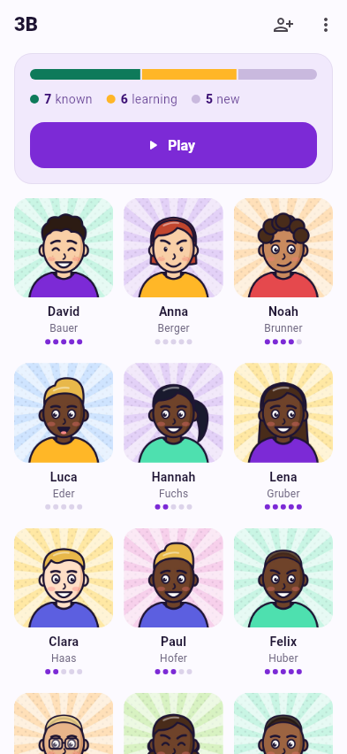

# Docs & screenshots

This site is built with [MkDocs Material](https://squidfunk.github.io/mkdocs-material/)
from the Markdown files in `docs/` and published to GitHub Pages. The
screenshots are **rendered automatically** – nobody has to import a class on a
phone and press buttons.

```text
mkdocs.yml                         site settings and navigation
docs/
  index.md, user-guide/, developers/   the pages
  assets/screenshots/              rendered by CI – don't edit by hand
  assets/stylesheets/extra.css     brand colours, phone frames, layouts
  demo/                            demo class: CSV + avatars (generated, also bundled in the app)
screenshot_test/screenshots_test.dart   renders the screenshots
tool/demo/generate_demo.py         generates the demo class
.github/workflows/
  screenshots.yml                  renders + commits screenshots
  docs.yml                         builds the site, deploys from main
```

## How it fits together

1. **Demo data** – `tool/demo/generate_demo.py` invents 28 students, draws a
   comic avatar for each and writes `docs/demo/demo-classes.csv` (same layout
   as a WebUntis export) plus `avatars.zip`. The same CSV and avatars are app
   assets (`pubspec.yaml`), so **+ → Load demo classes** in the app shows
   exactly what the documentation shows.
2. **Screenshots** – `screenshot_test/screenshots_test.dart` is a Flutter
   widget test. It starts with an empty app folder, imports the CSV with the
   app's real `FileImporter`, attaches the avatars, fills in believable
   progress (levels, a 7-day streak, history, badges) and then opens each
   screen and game, taps where needed and saves a PNG with `matchesGoldenFile`.
   Flutter renders in memory – no emulator. Real Roboto and Material Icons
   fonts are loaded from the Flutter SDK, so text isn't drawn as boxes.
3. **Screenshots workflow** – runs the test with `--update-goldens` whenever
   `lib/`, the test or the demo data change, and commits changed PNGs back to
   the branch.
4. **Docs workflow** – builds the site with `mkdocs build --strict` (broken
   links fail the build) and deploys it to Pages on pushes to `main`.

## Writing docs

```bash
pip install -r docs/requirements.txt
mkdocs serve          # http://127.0.0.1:8000, reloads on save
```

!!! note "MkDocs is pinned below 2.0"
    MkDocs 2.0 drops the plugin and theme system that Material for MkDocs
    relies on, so `docs/requirements.txt` keeps `mkdocs<2`. The Material team's
    successor, [Zensical](https://zensical.org), builds the same `mkdocs.yml`
    if the site ever needs to move.

Screenshot layouts used on the pages:

```markdown
{ .shot }      <!-- phone frame -->

<div class="side" markdown>       <!-- text left, screenshot right -->
<div markdown>
Text …
</div>

{ .shot }
</div>

<div class="shots" markdown>      <!-- several side by side -->
{ .shot }
{ .shot }
</div>
```

## Adding or changing a screenshot

Add a line to `screenshot_test/screenshots_test.dart`:

```dart
await shoot(tester, store, const SettingsScreen(), 'settings');

// with an interaction before the picture:
await shoot(tester, store, ClassScreen(classId: cls3b.id), 'game-picker', before: (t) async {
  await t.tap(find.text('Play'));
});
```

Push – the workflow renders it into `docs/assets/screenshots/<name>.png`.
To render locally instead:

```bash
flutter test --update-goldens screenshot_test/
```

German screenshots: `flutter test --update-goldens --dart-define=SHOT_LOCALE=de screenshot_test/`.

!!! note "Screenshots change on every run"
    Games pick students at random, so game screenshots differ a little each
    time the workflow runs. That's expected.

## Changing the demo class

Edit `STUDENTS` in `tool/demo/generate_demo.py` and run it (needs
`rsvg-convert` from librsvg and ImageMagick):

```bash
python3 tool/demo/generate_demo.py
```

The avatars are reproducible (fixed random seed), so unchanged students keep
their faces. The app bundles every file in `docs/demo/avatars/`, and a test
in `test/widget_test.dart` checks that each student in the CSV has its
avatar – so a changed demo class also means a new APK build.

## Publishing

One-time setup in the repository: **Settings → Pages → Build and deployment
→ Source: GitHub Actions**. After that, every push to `main` that touches
`docs/` or `mkdocs.yml` publishes the site to
<https://lukasdiem.github.io/nameit/>. The screenshot workflow's own commits
don't start other workflows – run **Actions → Docs → Run workflow** to
publish fresh screenshots right away, or they go out with the next docs change.
