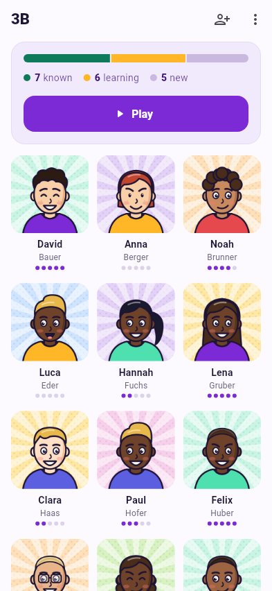
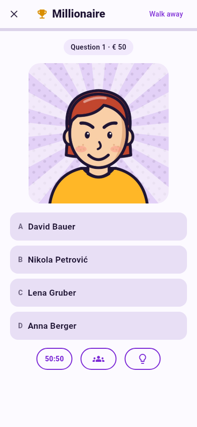

---
hide:
  - navigation
  - toc
---

# Every face. Every name.

**nameIT** helps teachers learn the names and faces of their students – with
seven short games instead of staring at a class list.

Import your classes from **WebUntis**, a **CSV/Excel** file or just type the
names. Everything stays on your phone.

[Get started](user-guide/getting-started.md){ .md-button .md-button--primary }
[See the games](user-guide/games.md){ .md-button }

{ .shot }
{ .shot }

-   :material-cloud-download-outline: **Import in minutes**

    ---

    Sign in to WebUntis with the QR code and pick your classes – names *and*
    photos come along. Or use a CSV/Excel export.

    [:octicons-arrow-right-24: Importing students](user-guide/import/index.md)

-   :material-gamepad-variant-outline: **Seven games**

    ---

    Millionaire, Memory, Who is it?, Blitz, Reveal, Type it and Flashcards –
    face → name and name → face.

    [:octicons-arrow-right-24: Games](user-guide/games.md)

-   :material-brain: **Practice where it matters**

    ---

    Every answer moves a student up or down five levels. Games pick the faces
    you don't know yet – and the ones you haven't seen for a while.

    [:octicons-arrow-right-24: How learning works](user-guide/learning.md)

-   :material-fire: **Streaks & badges**

    ---

    XP, a daily streak, a 14-day chart and 15 badges – from *Early bird* to
    *Walking class register*.

    [:octicons-arrow-right-24: Stats & badges](user-guide/stats.md)

-   :material-shield-lock-outline: **Private by design**

    ---

    No account, no cloud, no backend. Names and photos live only in the app's
    private storage on your phone.

    [:octicons-arrow-right-24: Settings & privacy](user-guide/settings.md)

-   :material-translate: **German & English**

    ---

    The app follows your phone's language, or you switch it in Settings.

    [:octicons-arrow-right-24: Settings](user-guide/settings.md)

!!! example "Just want to look around?"

    Download the made-up [demo class](user-guide/demo-class.md) – 28 comic
    students with photos – and import it into the app. Every screenshot in this
    documentation was made with it.
