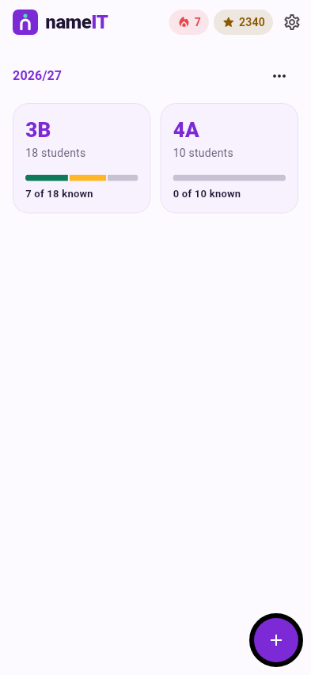
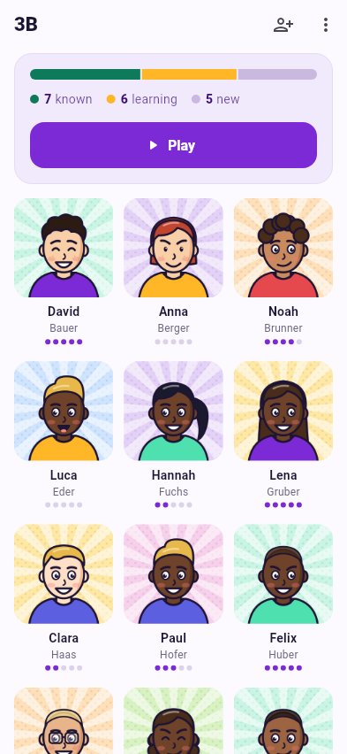
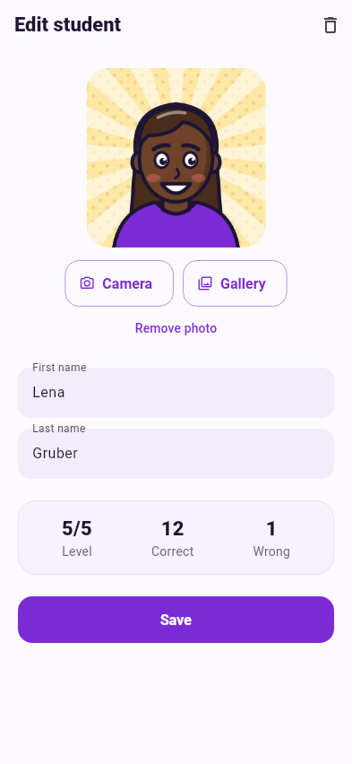

# Classes, students & photos

## Home screen

The home screen shows your **school years** as sections, newest first, with a
card per **class**. Each card shows the number of students and a bar of how
well you know them:

* **grey** – new
* **amber** – learning
* **mint** – known

The **flame** and **star** at the top are your daily streak and XP. Tap them
to open [Stats & badges](stats.md). The gear opens [Settings](settings.md).

**+** opens the menu to import data or create a school year or class by hand.
The **⋯** next to a school year adds a class to it, renames it or deletes it
(including all its classes, photos and progress).

{ .shot }

## Class

Tap a class card to open it. At the top:

* the learning bar with counts for **new / learning / known**,
* a hint how many students still have **no photo**,
* the **Play** button, which opens the [game picker](games.md).

Below is every student with photo, first and last name and five dots for
their [level](learning.md).

In the top bar you can **add a student** (person icon) or **rename / delete**
the class (⋮).

{ .shot }

## Student

Tap a student to edit first and last name or the photo. The numbers at the
bottom show their **level** (0–5) and how often you answered **correctly** or
**wrongly**.

The bin icon in the top bar deletes the student.

### Photos { #photos }

* **Camera** – take a photo now. Students often don't mind a quick portrait
  on the first day.
* **Gallery** – pick an existing picture.
* **Remove photo** – back to the coloured initials tile.

Photos are scaled down to at most 800 × 800 pixels and stored inside the app.

!!! tip "Only students with a photo play"
    Games use only students who have a photo. Most games need at least four;
    *Type it* and *Flashcards* work with one.

{ .shot }

