# Try it with the demo class

All screenshots in this documentation use a **made-up class**: 28 comic
students in two classes. You can import the same class into the app to try
everything without real student data – handy for showing nameIT to
colleagues, too.

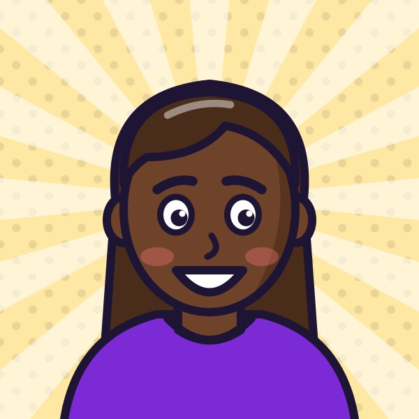{ title="Lena Gruber" }
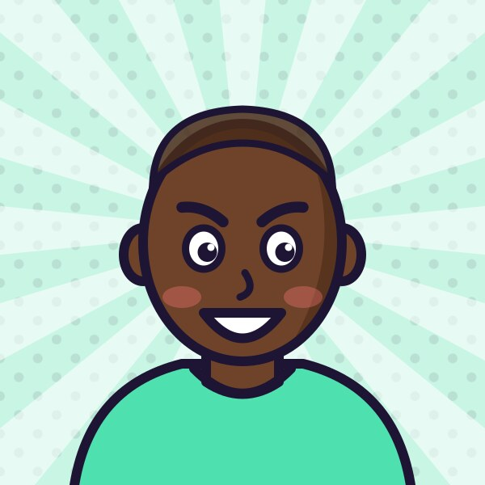{ title="Felix Huber" }
{ title="Anna Berger" }
{ title="Jonas Wagner" }
{ title="Sophie Pichler" }
{ title="Elias Moser" }
{ title="Emma Steiner" }
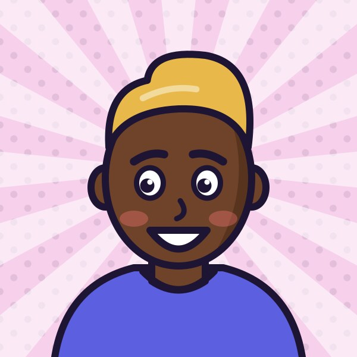{ title="Paul Hofer" }
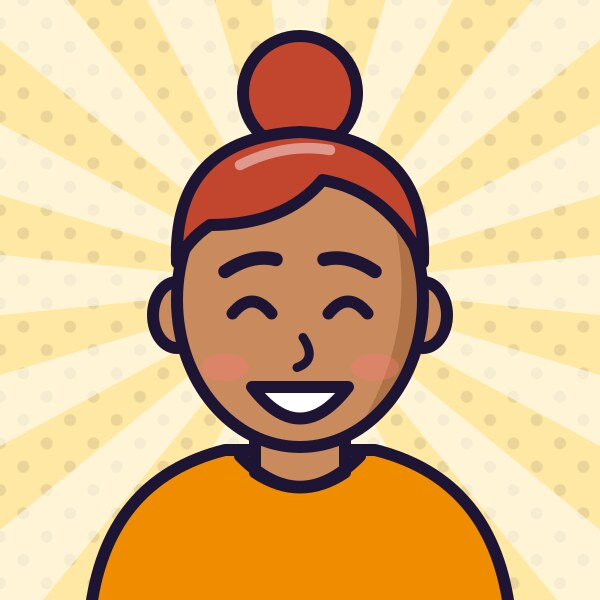{ title="Zeynep Yılmaz" }
{ title="David Bauer" }
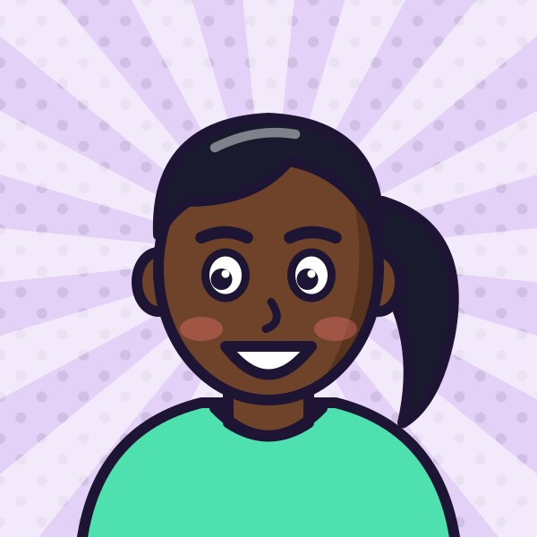{ title="Hannah Fuchs" }
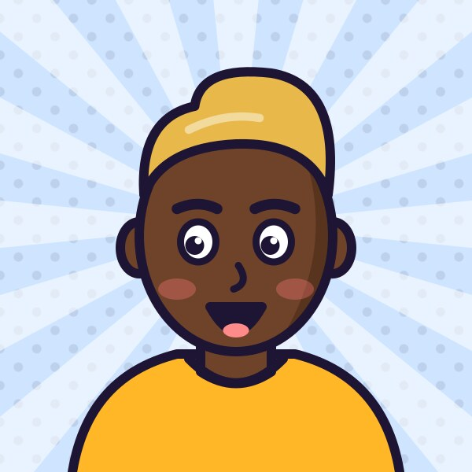{ title="Luca Eder" }
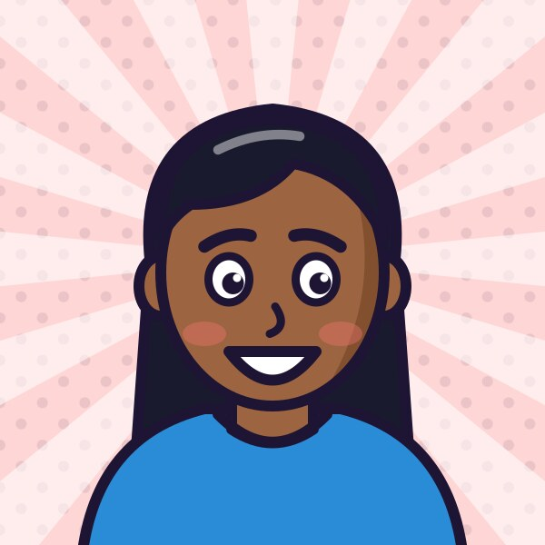{ title="Marie Schwarz" }
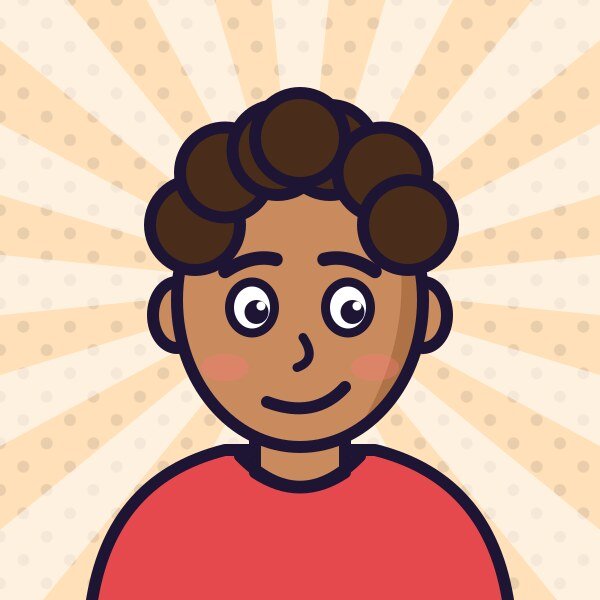{ title="Noah Brunner" }
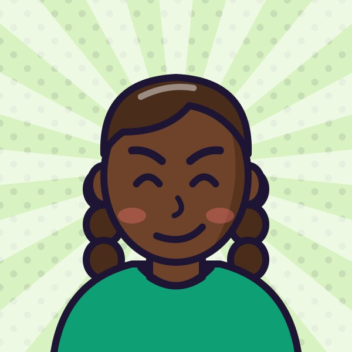{ title="Amara Okafor" }
{ title="Tobias Winkler" }
{ title="Clara Haas" }
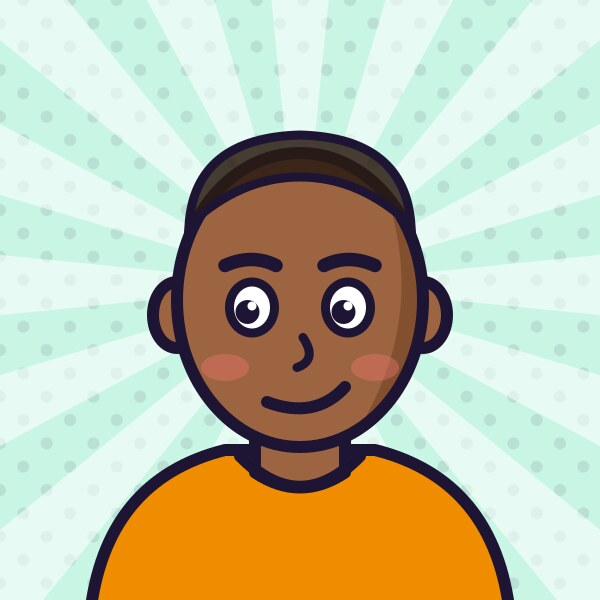{ title="Nikola Petrović" }

{ title="Laura Mayr" }
{ title="Ben Aigner" }
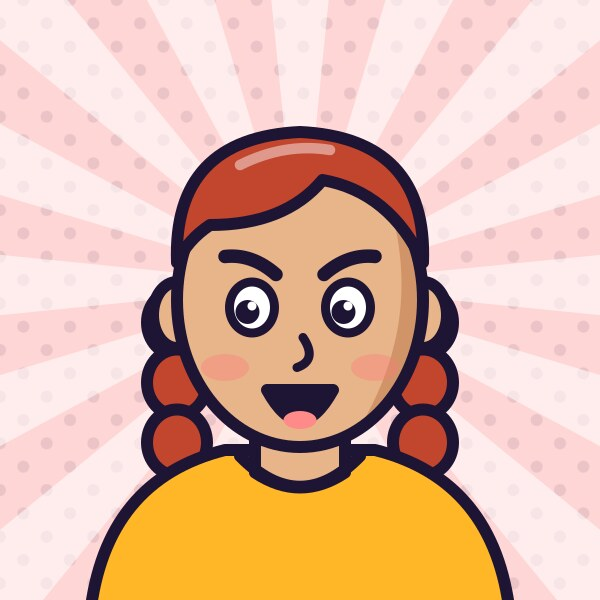{ title="Mia Leitner" }
{ title="Amir Kaya" }
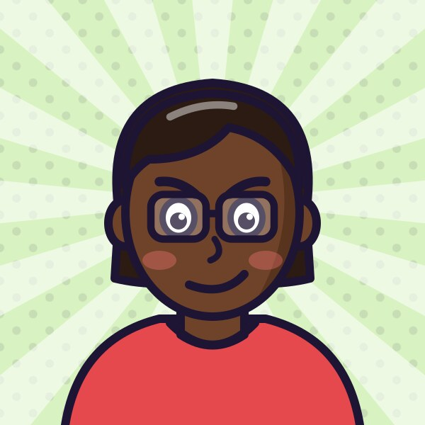{ title="Valentina Rossi" }
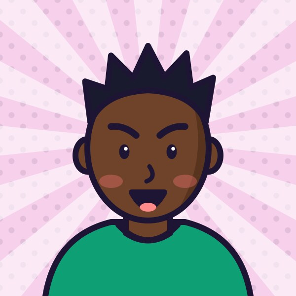{ title="Jakob Lehner" }
{ title="Lea Wimmer" }
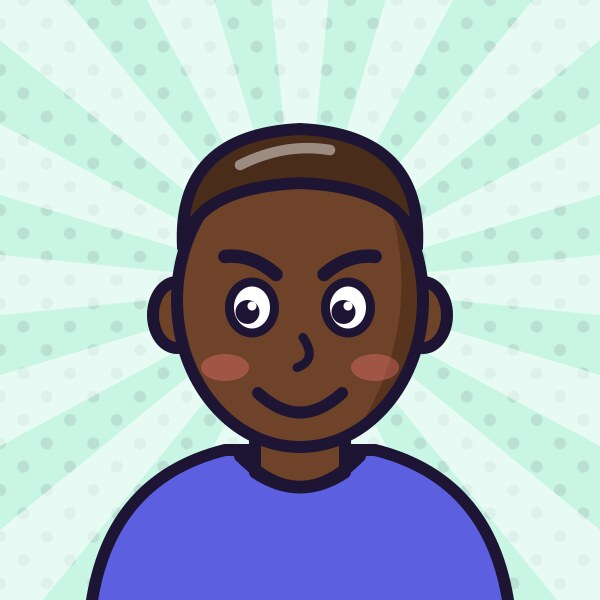{ title="Matteo Fischer" }
{ title="Ida Schmid" }
{ title="Simon Egger" }

## Load it in the app

The demo class comes with the app – one tap, photos included:

* On the **empty home screen**: tap **Try it with demo classes first**.
* Any time later: **+ → Load demo classes**.

Classes **3B** (18 students) and **4A** (10) appear in a school year called
**Demo**, kept apart from your real classes. Tap **Play** and every game is
unlocked.

Loading it again doesn't create duplicates. To remove it, open the **⋯** menu
next to the school year **Demo** and choose **Delete**.

## Downloads

The same files, e.g. to try the [file import](import/file.md) yourself:

| File | What it is |
|---|---|
| [:material-file-delimited: demo-classes.csv](../demo/demo-classes.csv) | Class list: classes **3B** (18 students) and **4A** (10) |
| [:material-folder-zip: avatars.zip](../demo/avatars.zip) | All 28 avatars as JPG, named `firstname-lastname.jpg` |

The `Foto` column in the CSV says which picture belongs to whom. The file
import ignores that column – with a file import, photos are added one student
at a time via **Gallery**.

## Where it comes from

The names are invented and common in Austria. The avatars are drawn by a
small script, [`tool/demo/generate_demo.py`](https://github.com/lukasdiem/nameit/blob/main/tool/demo/generate_demo.py),
from random combinations of hair, eyes, mouth, glasses and colours – no
photos or real people involved.
