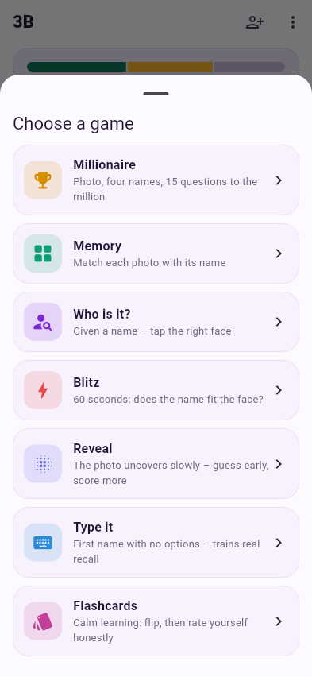
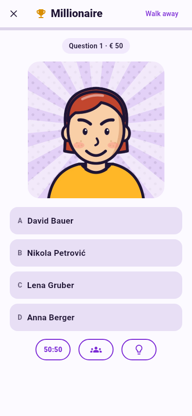
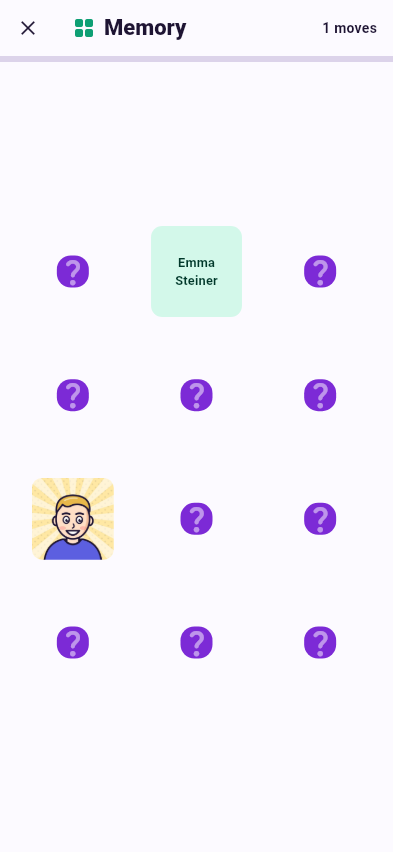
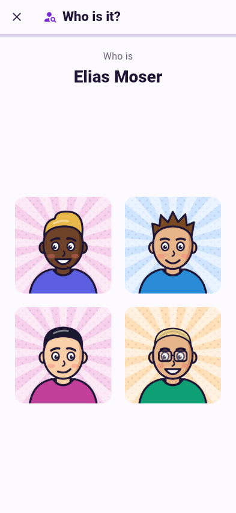
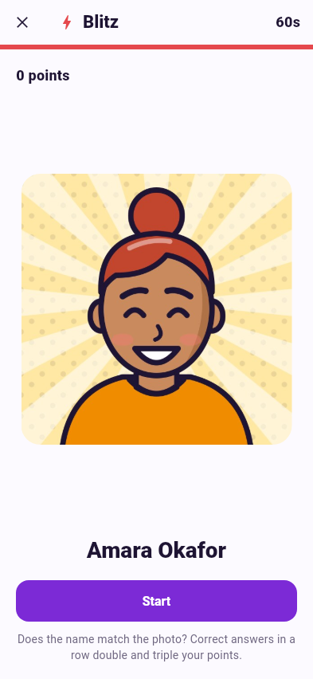
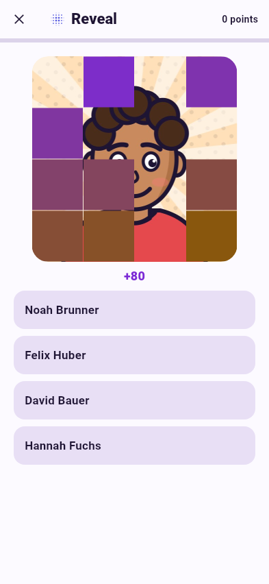
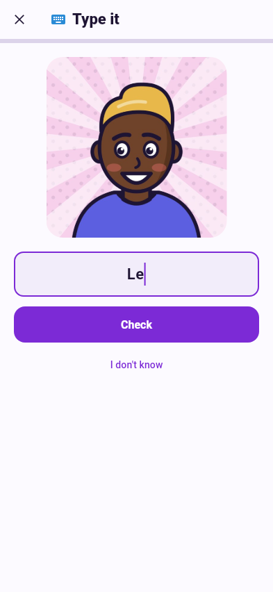
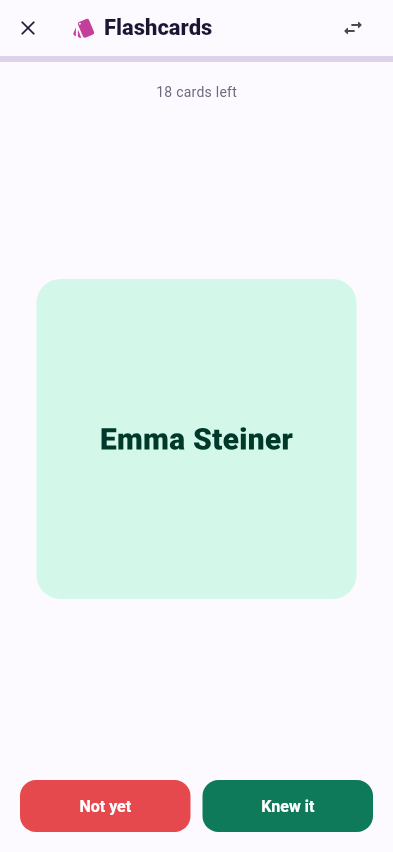
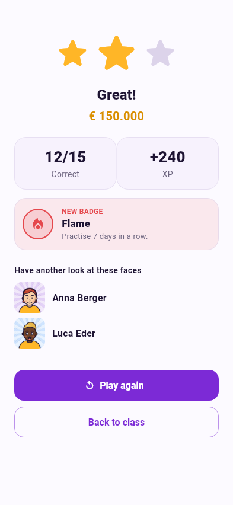

# Games

Open a class and tap **Play**. Every game draws from the students of that
class who have a photo, and every answer counts towards their
[learning level](learning.md).

| Game | Direction | Needs |
|---|---|---|
| [Millionaire](#millionaire) | face → name | 4 photos |
| [Memory](#memory) | both | 3 photos |
| [Who is it?](#who-is-it) | name → face | 4 photos |
| [Blitz](#blitz) | face ↔ name | 2 photos |
| [Reveal](#reveal) | face → name | 4 photos |
| [Type it](#type-it) | face → name | 1 photo |
| [Flashcards](#flashcards) | both | 1 photo |

Games that need more photos than the class has are greyed out.

**Recognising** a face among four names is easy; **recalling** a name with no
options is hard. *Type it* and *Flashcards* train recall – play them once the
multiple-choice games feel easy.

{ .shot }

---

## Millionaire { #millionaire }

A photo and four names – 15 questions up the money ladder to **€ 1.000.000**.

* **Safety levels** at € 500 and € 15.000: a wrong answer drops you to the
  last one you passed.
* A wrong answer ends the run. **Walk away** keeps what you have.
* Three jokers, once per game:
    * **50:50** removes two wrong names.
    * **Audience** shows a poll – the audience is less sure about students
      you don't know well yet.
    * **Initials** shows the student's initials.

Winning the million unlocks the *Millionaire* badge.

{ .shot }

## Memory { #memory }

Up to six pairs of cards: one with the **photo**, one with the **name**.
Flip two at a time and find the pairs.

Stars depend on how many moves you needed – six pairs in six moves is
perfect. Putting a photo next to the wrong name counts as a mistake for that
student.

{ .shot }

## Who is it? { #who-is-it }

The other direction: you get a **name** and tap the right **face** out of
four. Ten rounds.

Useful for the moment you read a name on a test paper and need to know who
it is.

{ .shot }

## Blitz { #blitz }

**60 seconds**: a photo and a name – does it match? Tap ✓ or ✗ as fast as
you can.

Right answers in a row build a **combo**: from 5 in a row your points count
double, from 10 triple. A wrong answer resets the combo. 30 points unlock
*Quick thinker*.

{ .shot }

## Reveal { #reveal }

The photo is hidden behind **16 tiles** that disappear one by one. Pick the
right name out of four as early as you can – the fewer tiles are gone, the
more points. Eight rounds.

{ .shot }

## Type it { #type-it }

A photo and an empty text field: **type the first name**. No options to pick
from, so this trains real recall. Ten rounds.

Small typos are forgiven – one wrong letter in names with five or more
letters. For double names the first one is enough (*Anna* for *Anna Maria*).
**I don't know** shows the answer.

{ .shot }

## Flashcards { #flashcards }

Calm learning without a clock. See the face, think of the name, **flip** the
card and rate yourself honestly: **Knew it** or **Not yet**.

Cards you didn't know come back a few cards later until you know them all.
The arrows in the top bar switch the direction (name first, then face).

{ .shot }

---

## After the game

The result screen shows

* up to **three stars**,
* correct answers and **XP** earned,
* any **badges** you just unlocked,
* the faces you got wrong – **Have another look at these faces**.

**Play again** starts the same game with a new selection of students.

{ .shot }

