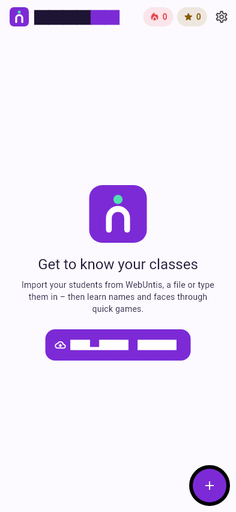

# Getting started

## Install the app

nameIT is not in the Play Store yet. Every build is published on GitHub as an
APK you can install directly on an Android phone.

[:material-android: Download the app](https://github.com/lukasdiem/nameit/releases){ .md-button .md-button--primary data-latest-apk }
<small class="download-note"><span data-latest-apk-version>newest version</span></small>

1. Open this page on your phone and tap **Download the app** – it always
   fetches the newest version.
2. Open the downloaded file. Android asks once whether your browser may
   install apps – allow it.

??? info "Permanent download link"

    To share or bookmark, use

    ```text
    https://github.com/lukasdiem/nameit/releases/latest/download/nameit.apk
    ```

    It always points to the newest **full release** (tagged versions like
    `v0.2.0`). Test builds from every change are listed on the
    [Releases page](https://github.com/lukasdiem/nameit/releases) as
    *pre-releases*.

!!! tip "Updates keep your data"

    Every build is signed with the same key, so a newer APK installs over the
    old one and your classes, photos and progress stay. Uninstalling the app
    deletes them.

!!! note "iPhone"

    The app is iOS-ready but there is no iPhone build to download yet. You
    can build it yourself with Xcode – see [Building & releases](../developers/building.md).

## First start

<div class="side" markdown>
<div markdown>

The app opens with an empty home screen. Everything in nameIT is organised as

**School year → Class → Students**

Tap **Import data** to bring in your first class. You have three options:

| | Best for |
|---|---|
| [**WebUntis**](import/webuntis.md) | Your school uses WebUntis – imports classes *and* photos |
| [**CSV / Excel file**](import/file.md) | You have a student list exported from WebUntis or any spreadsheet |
| [**Manual**](import/manual.md) | A small group, or a quick try |

Just want to look around first? Tap **Try it with demo classes first** – see
[Demo class](demo-class.md).

The **+** button also lets you create a school year or an empty class by hand.

</div>

{ .shot }
</div>

## Your first game

1. Open a class on the home screen.
2. Make sure students have photos – games only use students with a photo
   ([adding photos](classes.md#photos)).
3. Tap **Play** and pick a game.

After the round you see stars, XP and the faces worth another look. The more
you play, the more the class bar on the home screen fills up:
<span style="opacity:.6">grey</span> = new, **amber** = learning,
**mint** = known. More in [How learning works](learning.md).
