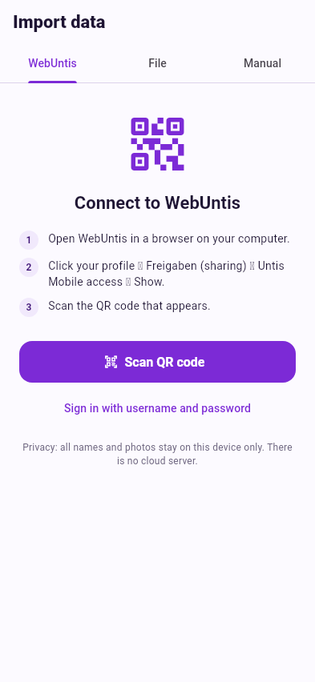
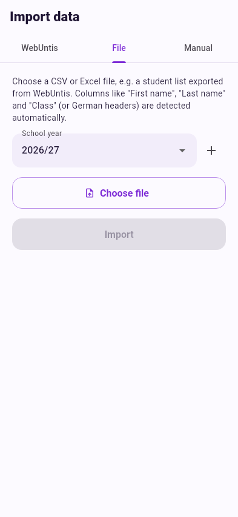
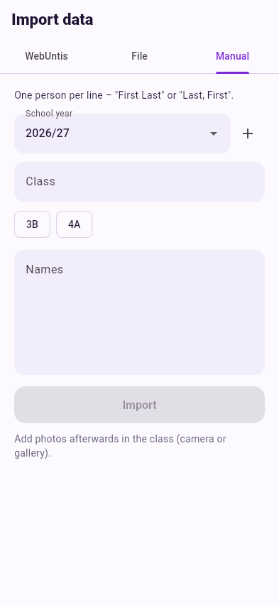

# Importing students

Open the import screen from the home screen: **+ → Import data** (or the
**Import data** button on an empty home screen). It has three tabs.

<figure markdown>
{ .shot }
<figcaption>[WebUntis](webuntis.md) – classes and photos straight from your school</figcaption>
</figure>
<figure markdown>
{ .shot }
<figcaption>[File](file.md) – a CSV or Excel student list</figcaption>
</figure>
<figure markdown>
{ .shot }
<figcaption>[Manual](manual.md) – type or paste names</figcaption>
</figure>

## Importing again is safe

You can import the same class again at any time, e.g. when a new student
joins. nameIT matches students by their WebUntis ID or by first and last name
and **keeps their learning progress and photo**. Only new students are added.

## Photos

Games only use students who have a photo.

* The **WebUntis** import can load the official student photos.
* For **file** and **manual** imports, add photos afterwards: open the class,
  tap a student, then **Camera** or **Gallery** – see
  [Classes, students & photos](../classes.md#photos).
