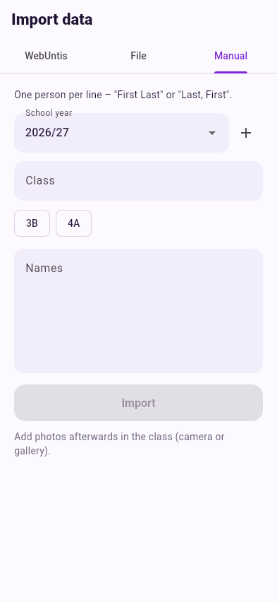

# Type or paste names

The quickest way for a small group, or when you only have a printed list.

<div class="side" markdown>
<div markdown>

1. Open **Import data → Manual**.
2. Pick the **school year** and type the **class** name, e.g. `3B`.
3. Enter one person per line, in either form:

    ```text
    Anna Berger
    Max Huber
    Leitner, Sophie
    ```

    `First Last` is split at the last space, `Last, First` at the comma.

4. Tap **Import**.

Then add photos in the class – camera or gallery – see
[Classes, students & photos](../classes.md#photos).

</div>

{ .shot }
</div>

!!! tip "Pasting from a spreadsheet"
    Copy a column of full names from Excel or a document and paste it into
    the field – each line becomes one student.
