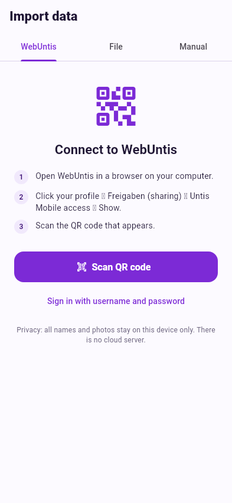

# Import from WebUntis

If your school uses WebUntis, nameIT can fetch your classes, students and –
if your school stores them – their photos.

## 1. Sign in

=== "QR code (recommended)"

    1. On a computer, open WebUntis in the browser.
    2. Click your **profile** → **Freigaben** (sharing) →
       **Zugriff über Untis Mobile** → **Anzeigen**.
    3. In nameIT tap **Scan QR code** and point the camera at the code.

    The QR code contains your server, school, user name and an app key – no
    password needed.

=== "Only one phone"

    1. Open WebUntis in the phone's browser and sign in.
    2. Tap your **profile** → **Freigaben** (sharing) →
       **Zugriff über Untis Mobile** → **Anzeigen**.
    3. Take a **screenshot** of the QR code.
    4. In nameIT tap **Scan QR code** → **Choose from image** and pick the
       screenshot.

    !!! warning "Delete the screenshot afterwards"
        The code contains your app key. Once nameIT is connected, delete the
        screenshot from your gallery.

=== "User name and password"

    Tap **Sign in with username and password** and fill in server, school,
    user name and password.

    !!! tip
        Paste the address of your school's WebUntis login page into the
        **Server** field – server and school are filled in automatically.

{ .shot }

After the first successful sign-in nameIT keeps only the **app key** in the
phone's secure storage (Android Keystore / iOS Keychain) and signs in
automatically next time. **Sign out** deletes it.

### Several schools or accounts { #accounts }

Teaching at more than one school? Tap the **person +** icon next to your
account to connect another one – same QR code steps. nameIT keeps all of
them. With two or more, your account line becomes a menu: pick a school and
its school years and classes load. nameIT opens with the account you used
last. **Sign out** removes only the selected account.

## 2. Pick the school year and classes

nameIT lists the school years from WebUntis. After choosing one you see:

* **Your classes** – the classes you actually teach, found through your
  timetable, each with the number of students from your lessons.
* **Other classes** – every other class of the school, searchable.

Tick the classes you want. Leave **Load photos from WebUntis** on to get the
student photos.

## 3. Import

Tap **Import N classes**. nameIT creates the school year and classes and shows
a summary per class: students and how many of them came with a photo.

## How nameIT finds the students of a class

WebUntis doesn't hand out class lists to every teacher, so nameIT tries three
ways, in this order:

1. **Class list of the web timetable** – works for the class you are *class
   teacher* (Klassenvorstand) of, and gives the full class.
2. **Attendance lists of your lessons** – through the interface the official
   Untis Mobile app uses. This finds every student you actually teach. If a
   lesson is shared by several classes and they can't be told apart, it
   becomes its own group, e.g. *Shared lesson 3A + 3B*.
3. **Pick by hand** – if neither works, nameIT shows the school's student list
   and asks: *Who is in 3B?* Tick the students and tap **Use N**.

## Photos

Photos are loaded with your login from your school's WebUntis server.
Students without a real photo (WebUntis shows a generic avatar) are left
without one, so you can take or pick a photo yourself.

If your WebUntis server keeps photos at an unusual address, set it under
[Settings → Custom photo address](../settings.md#custom-photo-address).

!!! warning "Photos are personal data"
    Only import photos if your school allows you to use them for this purpose.
    They stay on your phone – see [Settings & privacy](../settings.md#privacy).
