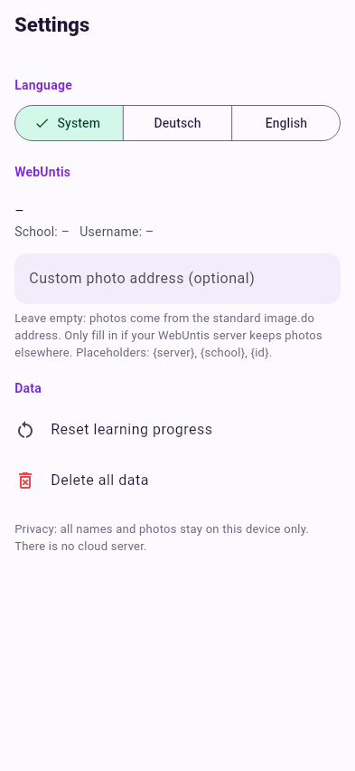
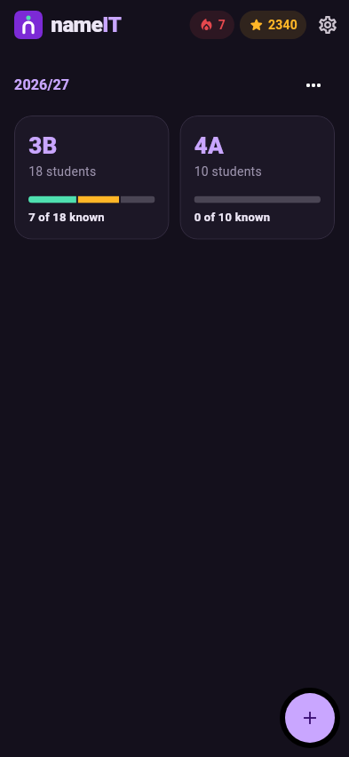

# Settings & privacy

Open **Settings** with the gear on the home screen.

<div class="side" markdown>
<div markdown>

## Language

**System** follows the phone's language (German or English, everything else
falls back to English). **Deutsch** and **English** force one language.

## WebUntis

Shows the server, school and user of your last WebUntis sign-in.

### Custom photo address { #custom-photo-address }

Leave it **empty** – photos then come from WebUntis' standard address:

```text
https://<server>/WebUntis/image.do?cat=5&id=<student id>
```

Only fill it in if your school's server keeps photos elsewhere. Placeholders:
`{server}`, `{school}`, `{id}`.

## Data

* **Reset learning progress** – all levels back to 0; XP, streak, history and
  badges cleared. Classes, students and photos stay.
* **Delete all data** – removes every school year, class, photo and all
  progress from the phone.

</div>

{ .shot }
</div>

## Privacy { #privacy }

Names and photos of students are personal data (GDPR). nameIT is built so
that they never leave your phone:

* **No backend, no account, no analytics.** There is no nameIT server.
* Data lives in the app's **private storage** – one data file plus a folder of
  photos. Other apps can't read it.
* The only network connection is to **your school's WebUntis server**, and
  only when you import.
* The WebUntis **app key** is kept in the Android Keystore / iOS Keychain.
  **Sign out** on the import screen deletes it.
* **Delete all data** or **uninstalling** the app removes everything.

!!! warning "Check with your school"
    Whether you may keep student photos on a personal phone is up to your
    school and its data protection rules. nameIT keeps them as safe as the
    phone itself – use a screen lock.

## Dark mode

nameIT follows the phone's light or dark mode.

<div class="shots" markdown>
{ .shot }
{ .shot }
</div>
