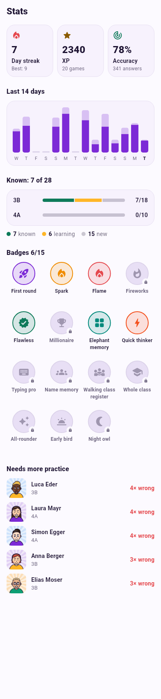

# Stats & badges

Tap the **flame** or the **star** on the home screen to open the stats.

Stats start fresh every **school year** (1 August to 31 July). The school year
at the top right switches between years – e.g. to look back at last year.
The **streak** and the **badges** are yours for good and don't reset. The XP
on the home screen are those of the current school year.

* **Day streak** – days in a row with at least one answer, and your record.
* **XP** and the number of games played this school year.
* **Accuracy** – share of correct answers this school year.
* **Last 14 days** – answers per day; tap a bar for the numbers.
* **Per class** – how many students you know, for the classes of this school year.
* **Needs more practice** – the students with the lowest level and the most
  mistakes. Good candidates for a round of *Flashcards*.
* **Badges** – unlocked ones in colour, locked ones grey. Tap one to see what
  it takes or when you got it.

{ .shot }

## All 15 badges

New badges are announced on the result screen after a game.

| Badge | How to get it |
|---|---|
| :material-rocket-launch: **First round** | Finish your first game. |
| :material-fire: **Spark** | Practise 3 days in a row. |
| :material-fire: **Flame** | Practise 7 days in a row. |
| :material-fire-alert: **Fireworks** | Practise 30 days in a row. |
| :material-check-decagram: **Flawless** | Answer at least 8 questions in a game without a mistake. |
| :material-trophy: **Millionaire** | Win the million in Millionaire. |
| :material-view-grid: **Elephant memory** | Solve a Memory with at most 2 extra moves. |
| :material-lightning-bolt: **Quick thinker** | Score 30 points in Blitz. |
| :material-keyboard: **Typing pro** | Type every first name right in one round. |
| :material-account-group: **Name memory** | Master 25 students. |
| :material-account-multiple: **Walking class register** | Master 100 students. |
| :material-school: **Whole class** | Master every student of a class (at least 5). |
| :material-auto-fix: **All-rounder** | Play each of the 7 game modes at least once. |
| :material-weather-sunset-up: **Early bird** | Finish a game between 5 and 7 in the morning. |
| :material-weather-night: **Night owl** | Finish a game between 10 pm and 5 am. |

*Master* means level 5 – see [How learning works](learning.md).
